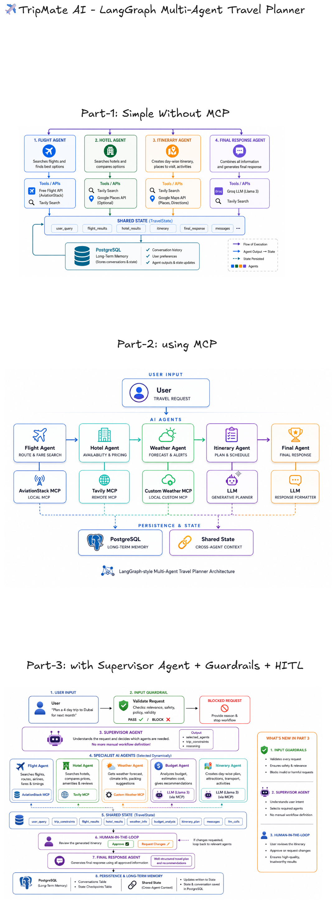

# Multi-Agent-System-using-LangGraph-MCP-Supervisor-Guardrails-HITL

A demo multi-agent system that uses LangGraph and MCP to implement a travel-planning assistant with a Supervisor, input Guardrails, and Human-In-The-Loop (HITL) approval flows. The project includes a FastAPI frontend, example MCP server, and client helpers to demonstrate how agents, supervisors, and guardrails can be composed into a safe, reviewable planning pipeline.

Key ideas:
- Multi-agent coordination using LangGraph and MCP
- Supervisor agent to manage complex workflows
- Input guardrails to validate user requests
- Human-in-the-loop approval for generated plans

Contents
- `app.py`: FastAPI web frontend and API endpoints
- `backend.py`: core agent orchestration / travel-planner logic
- `mcp_client.py`: client helpers to interact with the MCP server
- `custom_weather_mcp_server.py`: example MCP server for weather checks
- `templates/`, `static/`: frontend UI assets (HTML, JS, CSS)

Features
- Interactive web UI for sending travel planning prompts
- Endpoint for drafting travel plans and separate approval endpoint
- Example MCP server demonstrating domain adapters (weather, checkpoints)

Architecture


Demo


Prerequisites
- Python 3.10+ (recommended)
- Git (to clone the repo)
- A virtual environment tool (venv) or similar

Quick start (Windows)

1. Create and activate a virtual environment

```powershell
python -m venv .venv
.venv\Scripts\Activate.ps1    # PowerShell
```

2. Install dependencies

```powershell
pip install -r requirements.txt
```

3. Run the FastAPI app (development)

```powershell
# option A (run module)
python app.py

# option B (uvicorn)
uvicorn app:app --reload --host 127.0.0.1 --port 8000
```

4. Open the web UI

Visit http://127.0.0.1:8000 in your browser to use the TripMate frontend.

## Weather MCP Server

The weather server supports both stdio (the default) and Streamable HTTP. In stdio mode it has no public URL or listening port. The app's MCP client launches it automatically as a subprocess when a weather tool is needed; no separate server terminal is required. HTTP mode is opt-in and exposes an MCP endpoint at `/mcp`.

### Who Can Access It

- The app's MCP client communicates with its server subprocess through stdin/stdout.
- Other local programs or users with permission to execute the script can launch their own server process.
- Remote users cannot connect directly in stdio mode. In HTTP mode, anyone who can reach the endpoint can use it unless you add authentication. Web app users can access the weather tools indirectly through the app's weather agent, subject to the web app's own access controls.

### Connect Another MCP Client

1. Install the project dependencies in a virtual environment as described in Quick start.
2. Create a `.env` file in the project root and set `OPENWEATHER_API_KEY` to your OpenWeather API key.
3. Add the following server entry to your MCP client's configuration, replacing `C:/path/to/project` with the absolute path to this project. The configuration location and format depend on the client; this example is for clients supporting `mcpServers`.

```json
{
	"mcpServers": {
		"weather": {
			"command": "C:/path/to/project/.venv/Scripts/python.exe",
			"args": [
				"C:/path/to/project/custom_weather_mcp_server.py"
			]
		}
	}
}
```

4. Enable or reload the server in your MCP client. The client starts its own server process and discovers these tools:

- `get_current_weather(city)`: current weather for a city.
- `get_forecast(city)`: the first five three-hour forecast entries for a city.

The server loads `.env` from the project directory regardless of the client's working directory. `OPENWEATHER_API_KEY` authenticates requests to OpenWeather; it does not authenticate MCP clients. Do not share or commit your actual key. HTTP transport is available, but authentication and HTTPS must be configured separately before public deployment.

### Use With Claude Desktop

1. Install the project dependencies and set `OPENWEATHER_API_KEY` in the project's `.env` file as described above. Claude Desktop will start the stdio server automatically.
2. Open Claude Desktop and go to Settings > Developer > Edit Config. On Windows, the configuration file is typically `%APPDATA%/Claude/claude_desktop_config.json`.
3. Merge the `weather` entry from the JSON example above into your configuration's `mcpServers` object. Replace `C:/path/to/project` with this project's absolute path, and preserve any existing server entries. Use forward slashes in the JSON paths as shown.
4. Fully quit and reopen Claude Desktop so it loads the new configuration.
5. In a new conversation, ask: "Use the weather tool to check the weather in London." Allow the tool call if Claude requests permission.

Claude Desktop launches the weather server automatically. Do not start the weather script or the FastAPI app separately for this connection. The integration exposes only `get_current_weather` and `get_forecast`, not the complete travel-planning workflow. Claude's web interface cannot directly launch this local stdio server.

### Manual Startup

To check standalone startup:

```powershell
python custom_weather_mcp_server.py
```

The startup message appears on stderr, keeping stdout reserved for JSON-RPC messages. The process waits for MCP input, not interactive commands. Do not type or press Enter in that terminal: blank lines are not valid JSON-RPC and cause parsing errors. Press Ctrl+C to stop. A separately started process is not used by the web app or another stdio client.

### Streamable HTTP Mode

Start a local HTTP server on a port separate from the travel app:

```powershell
python custom_weather_mcp_server.py --transport streamable-http --port 8001
```

Connect an MCP client using Streamable HTTP at `http://127.0.0.1:8001/mcp`. This is a protocol endpoint, not a browser-based user interface. The server defaults to binding only to `127.0.0.1`. The existing travel app and Claude Desktop configurations continue using stdio; HTTP mode does not change them automatically.

For deployment to a Python host such as Render or Railway:

- Install dependencies with `pip install -r requirements.txt`.
- Set `OPENWEATHER_API_KEY` as a hosting environment secret.
- Use the start command below, replacing `weather.example.com` with the actual public hostname. The port defaults to the hosting provider's `PORT` environment variable, or `8000` if unset. An explicit `--port` takes precedence.

```text
python custom_weather_mcp_server.py --transport streamable-http --host 0.0.0.0 --allowed-host "weather.example.com:*"
```

Use the platform's HTTPS endpoint, such as `https://weather.example.com/mcp`, with a remote MCP client. HTTP mode uses stateless requests and JSON responses. It runs only the weather tools and does not require Groq or PostgreSQL. Choose hosting that supports the MCP client's HTTP connection requirements.

DNS-rebinding protection stays enabled. Repeat `--allowed-host` for each additional trusted HTTP Host header, including internal health-check hosts if required by your platform. Avoid wildcard hostnames. Allowed hosts are not client authentication: put MCP-compatible authentication (OAuth where required by clients), HTTPS, and rate limiting in front of this endpoint before exposing it publicly. Otherwise callers can consume your OpenWeather quota. Remote Claude connector availability depends on your plan and organization settings.

API Endpoints
- `POST /api/travel` — create or resume a travel planning thread. JSON: `{ "message": "<user prompt>", "thread_id": "optional-thread-id" }`
- `POST /api/travel/approve` — approve or request revisions for a draft. JSON: `{ "thread_id": "<id>", "approved": true|false, "feedback": "optional" }`
- `GET /health` — basic health check and features list

Configuration & environment
- Secrets and API keys are not included in the repo. Use environment variables or a `.env` file for any required keys consumed by `langgraph`, `langchain`, or other adapters.

Development notes
- The async FastAPI endpoints run the synchronous agent helpers in a worker thread, allowing their MCP calls to use `asyncio.run()` without nesting event loops or patching asyncio.
- Tests are not included; to experiment, interact with the web UI or call the API endpoints directly.

Contributing
- Contributions are welcome. Please open issues or pull requests for bug fixes, documentation improvements, or new adapter examples.

License
- This repository follows the license in the `LICENSE` file.

Acknowledgements
- Built as a demonstration of LangGraph + MCP patterns with supervisor and guardrail concepts.

Contact
- For questions or suggestions, open an issue or contact the repository owner.
